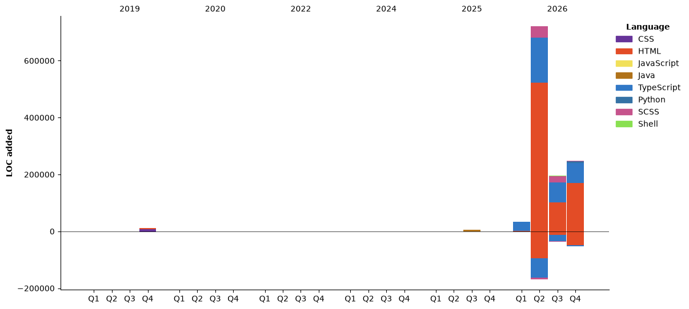

<!--
**Selogaz/Selogaz** is a ✨ _special_ ✨ repository because its `README.md` (this file) appears on your GitHub profile.

Here are some ideas to get you started:

- 🔭 I’m currently working on ...
- 🌱 I’m currently learning ...
- 👯 I’m looking to collaborate on ...
- 🤔 I’m looking for help with ...
- 💬 Ask me about ...
- 📫 How to reach me: ...
- 😄 Pronouns: ...
- ⚡ Fun fact: ...
-->
# Привет! / Hello! 👋

I'm **Alexander Terentyev**, a Frontend Developer passionate about building clean, efficient web applications and optimizing AI-assisted development workflows.  
Я **Александр Терентьев**, frontend-разработчик, увлеченный созданием качественных веб-приложений и оптимизацией рабочих процессов с помощью ИИ.

---

## 🛠 Tech Stack / Стек технологий

- **Frontend**: React, Next.js, TypeScript, Vue.js, TailwindCSS, SCSS, HTML5
- **Tools & Workflow**: Claude Code, VS Code, Git, Webpack, Gulp
- **OS & Environment**: Linux (Manjaro), Zsh, GNOME
- **Currently Learning / Изучаю**: Java, AI Agent integrations, Knowledge Management (Obsidian, Zotero)

---

## 🚀 Current Focus / Текущие проекты

- 🤖 **[AI-software-dev-skills](https://github.com/Selogaz/AI-software-dev-skills)**: Multi-session workflow skills for Claude Code to enforce strict Definition of Done and independent audits.
- 🎲 **[Maxwell's Dungeons](https://github.com/Selogaz/maxwell-case) (Подземелья Максвелла)**: An online AI-powered DnD platform *(in development)*.
- 🚚 **[Bite Transit](https://github.com/Selogaz/bite-transit-static)**: A responsive static website for a logistics company.

---

## 📫 Let's Connect / Связаться со мной

- **Telegram**: [@meaning_inside](https://t.me/meaning_inside) 
- **Email**: terentjev.selogaz@yandex.ru 
- **Portfolio**: [hh.ru](https://tuapse.hh.ru/resume/01c2d309ff0fe3e20f0039ed1f5a695936787a?hhtmFrom=applicant_profile)

---

<details>
<summary>📈 <b>GitHub Stats & Weekly Activity / Статистика и активность</b></summary>
<br>




<p align="left">
  
</p>

📊 This week I spent my time on:
<!--START_SECTION:waka-->


**🐱 My GitHub Data** 

> 📦 930.5 kB Used in GitHub's Storage 
 > 
> 🏆 662 Contributions in the Year 2026
 > 
> 🚫 Not Opted to Hire
 > 
> 📜 32 Public Repositories 
 > 
> 🔑 0 Private Repositories 
 > 
**I'm an Early 🐤** 

```text
🌞 Morning                287 commits         ███████░░░░░░░░░░░░░░░░░░   27.36 % 
🌆 Daytime                474 commits         ███████████░░░░░░░░░░░░░░   45.19 % 
🌃 Evening                229 commits         █████░░░░░░░░░░░░░░░░░░░░   21.83 % 
🌙 Night                  59 commits          █░░░░░░░░░░░░░░░░░░░░░░░░   05.62 % 
```
📅 **I'm Most Productive on Tuesday** 

```text
Monday                   150 commits         ████░░░░░░░░░░░░░░░░░░░░░   14.30 % 
Tuesday                  202 commits         █████░░░░░░░░░░░░░░░░░░░░   19.26 % 
Wednesday                169 commits         ████░░░░░░░░░░░░░░░░░░░░░   16.11 % 
Thursday                 159 commits         ████░░░░░░░░░░░░░░░░░░░░░   15.16 % 
Friday                   138 commits         ███░░░░░░░░░░░░░░░░░░░░░░   13.16 % 
Saturday                 111 commits         ███░░░░░░░░░░░░░░░░░░░░░░   10.58 % 
Sunday                   120 commits         ███░░░░░░░░░░░░░░░░░░░░░░   11.44 % 
```


📊 **This Week I Spent My Time On** 

```text
🕑︎ Time Zone: Europe/Moscow

💬 Programming Languages: 
JSON                     6 hrs 22 mins       ███████░░░░░░░░░░░░░░░░░░   28.18 % 
Python                   5 hrs 7 mins        ██████░░░░░░░░░░░░░░░░░░░   22.64 % 
Other                    4 hrs 26 mins       █████░░░░░░░░░░░░░░░░░░░░   19.67 % 
Markdown                 3 hrs 33 mins       ████░░░░░░░░░░░░░░░░░░░░░   15.71 % 
HTML                     1 hr 42 mins        ██░░░░░░░░░░░░░░░░░░░░░░░   07.52 % 

🔥 Editors: 
Claude Code              15 hrs 35 mins      █████████████████░░░░░░░░   68.95 % 
Codex Vscode             4 hrs 23 mins       █████░░░░░░░░░░░░░░░░░░░░   19.44 % 
VS Code                  2 hrs 23 mins       ███░░░░░░░░░░░░░░░░░░░░░░   10.57 % 
Codex CLI                9 mins              ░░░░░░░░░░░░░░░░░░░░░░░░░   00.67 % 
Codex Exec               4 mins              ░░░░░░░░░░░░░░░░░░░░░░░░░   00.37 % 

🐱‍💻 Projects: 
Obsidian-vault-cpp       9 hrs 3 mins        ██████████░░░░░░░░░░░░░░░   40.04 % 
tonsor-static            3 hrs 30 mins       ████░░░░░░░░░░░░░░░░░░░░░   15.49 % 
daylog                   3 hrs 28 mins       ████░░░░░░░░░░░░░░░░░░░░░   15.40 % 
shoptet                  1 hr 31 mins        ██░░░░░░░░░░░░░░░░░░░░░░░   06.73 % 
candidate-B              1 hr 19 mins        █░░░░░░░░░░░░░░░░░░░░░░░░   05.83 % 

💻 Operating System: 
Linux                    22 hrs 36 mins      █████████████████████████   100.00 % 
```

🤖 **AI Coding This Week** 

```text
⏱ AI Coding Time: 21 hrs 56 mins (97.0%)

✍️ 3,870 lines written by AI, 9 lines written by hand (99.77% AI-written)

🔤 12,636,191 Input Tokens, 861,358 Output Tokens

💵 $103.99 Estimated AI Cost This Week

🧠 54 AI Sessions, 189 AI Prompts

Sonnet                   2,086 lines         █████████████░░░░░░░░░░░░   53.32 % 
Opus                     1,279 lines         ████████░░░░░░░░░░░░░░░░░   32.69 % 
Fable                    336 lines           ██░░░░░░░░░░░░░░░░░░░░░░░   08.59 % 
GPT                      211 lines           █░░░░░░░░░░░░░░░░░░░░░░░░   05.39 % 
Haiku                    0 lines             ░░░░░░░░░░░░░░░░░░░░░░░░░   00.00 % 

🔎 AI Coding Insights:
🤖 AI-Driven — 99.77% of written lines came from AI
📚 Verbose Prompter — average 1,782 characters per prompt
🔁 Iterative Prompter — average 4 prompts per session
🚀 High AI Trust — 0.26% of changed lines were hand-edited
```

**I Mostly Code in TypeScript** 

```text
TypeScript               7 repos             ███████░░░░░░░░░░░░░░░░░░   26.92 % 
JavaScript               3 repos             ███░░░░░░░░░░░░░░░░░░░░░░   11.54 % 
Python                   3 repos             ███░░░░░░░░░░░░░░░░░░░░░░   11.54 % 
SCSS                     2 repos             ██░░░░░░░░░░░░░░░░░░░░░░░   07.69 % 
Shell                    1 repo              █░░░░░░░░░░░░░░░░░░░░░░░░   03.85 % 
```


**Timeline**




 Last Updated on 24/11/2026 12:41:34 UTC
<!--END_SECTION:waka-->
</details>
